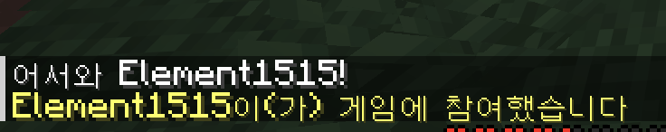

# MC-Plugin

Paper 26.2 플러그인. 직접 배우면서 만드는 중.

## 진행상황
| 단계 | 내용 | 상태 | 날짜 |
|---|---|---|---|
| 0 | Gradle + Paper API 세팅, runServer로 서버 기동 | 완료 | 2026-09-27 |
| 1 | PlayerJoinEvent 리스너, 접속 시 인사 메시지 | 완료 | 2026-09-27 |
| 2 | 이벤트 취소 (BlockBreakEvent) | 진행 예정 | |

### Step 1: 접속 인사
`PlayerJoinListener`에서 `event.getPlayer().sendMessage(Component)`로 출력. 문자열 대신 Adventure `Component` 써야 함.



## 실행
```bash
./gradlew runServer     # run/ 에 Paper 서버 받아서 플러그인 넣고 실행 (첫 실행 후 run/eula.txt 수정)
./gradlew build         # build/libs/ 에 jar
```
JDK 25 필요.

## 문서
- Paper 개발 문서: https://docs.papermc.io/paper/dev/
- Paper API Javadoc: https://jd.papermc.io/paper/26.2/
- Adventure(텍스트/MiniMessage): https://docs.advntr.dev/

## 과제 (순서대로, 하나씩 직접)
1. **이벤트 기초**: 플레이어가 접속하면 채팅으로 인사. `PlayerJoinEvent`, `Listener`, `@EventHandler`, `registerEvents`
2. **이벤트 취소**: 특정 블록(예: 기반암 위 잔디)은 못 부수게. `BlockBreakEvent#setCancelled`
3. **명령어**: `/hello` 치면 메시지. `LifecycleEvents.COMMANDS`, `Commands.literal`
4. **명령어 인자**: `/heal <플레이어>`. `Commands.argument`, `ArgumentTypes.player()`
5. **config**: 인사 메시지를 config.yml에서 읽기. `saveDefaultConfig`, `getConfig().getString`
6. **데이터 저장**: 플레이어별 블록 부순 개수 세기. `PersistentDataContainer`, `NamespacedKey`
7. **스케줄러**: 10초마다 서버 전체 공지. `getServer().getGlobalRegionScheduler().runAtFixedRate`
8. **텍스트 꾸미기**: 위 메시지들 전부 MiniMessage로. `MiniMessage.miniMessage().deserialize`
9. **인벤토리 GUI**: 명령어로 메뉴 열고 클릭 처리. `Bukkit.createInventory`, `InventoryClickEvent`
10. **커스텀 아이템**: 이름/로어/커스텀 모델 붙인 아이템 지급. `ItemStack`, `DataComponentTypes`

막히면 `reference/`에 1·3·5·6번 합쳐놓은 예제 있음. 보기 전에 먼저 문서 찾아보고.
